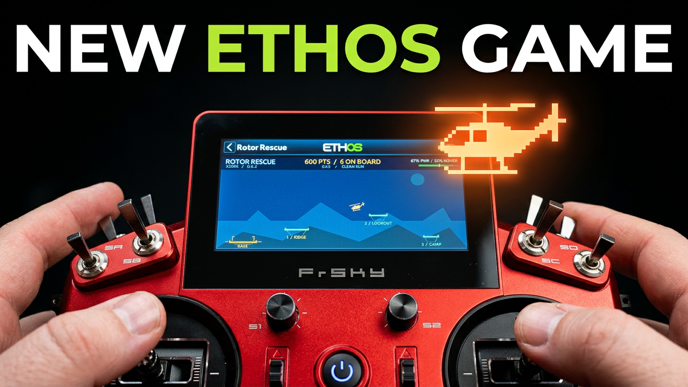
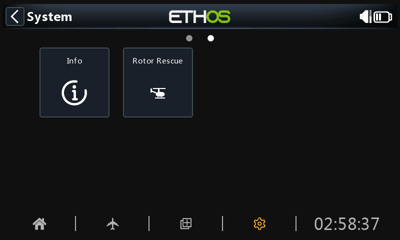
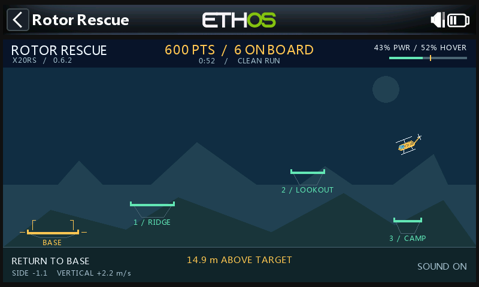
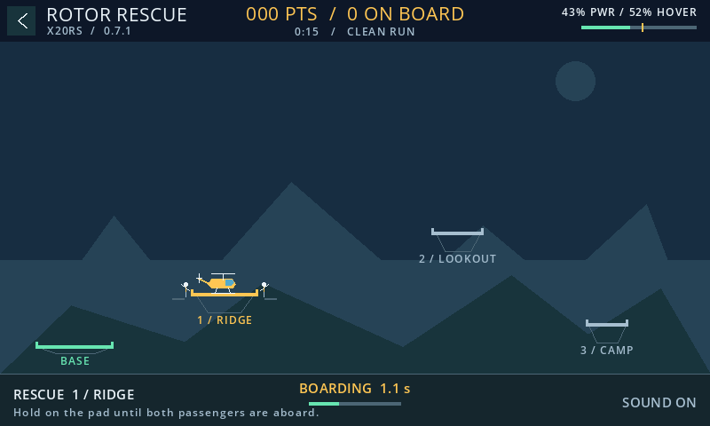
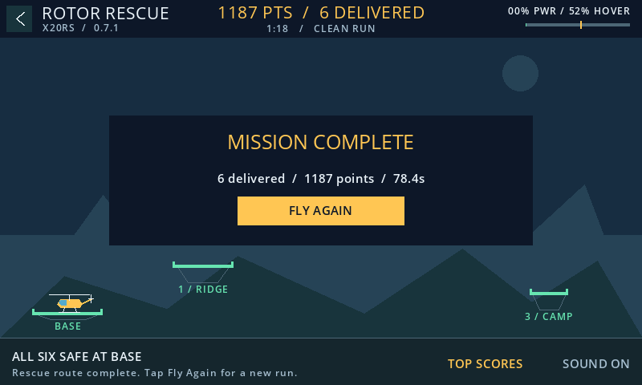
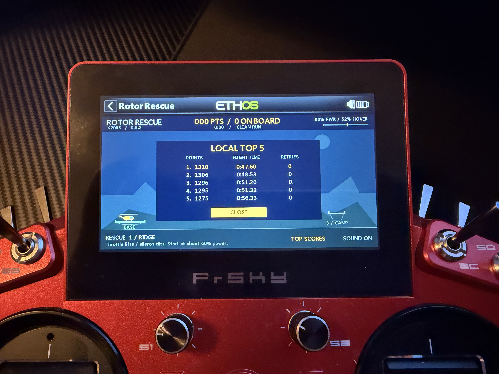

# Rotor Rescue

Fly a rescue helicopter with the sticks on your FrSky ETHOS radio. Pick up six passengers from three mountain pads and get them safely back to Base. The game runs directly on the radio as an ETHOS System tool.

**[Download Rotor Rescue 0.6.4](https://github.com/bliatun-code/RotorRescue/releases/download/v0.6.4/RotorRescue-0.6.4.zip)** · [Norsk veiledning](docs/Kom-i-gang.md)

[Watch a full flight on YouTube](https://www.youtube.com/watch?v=kaC_bujpgiw)

## Coming in 0.7.0

Version 0.7.0 is in testing and has not been released yet. Its scores are the same as in 0.6.4: the flight model and scoring are unchanged.

- **Full screen.** The game hides the ETHOS title bar and uses the whole 800 × 480 screen. Close it with the **‹** button at the top left or the RTN key.
- **Smoother drawing.** Each frame repaints only the part of the screen that changed, usually 2% of it, instead of clearing and repainting the whole window. Paints run about half as many Lua instructions, and frames allocate no memory.
- **New engine sound.** Ten rotor speed bands, pitch glides between them, and spool-up and wind-down sounds. The sound is tuned for the radio's small speaker, which barely reproduces the deep thump of the 0.6 sound.
- **Vibration** on a crash, on each pickup and when the mission is complete. ETHOS uses the haptic strength set under System.
- **Performance readout.** Tap the version line under the title to show frames per second and paint time.

## Radio compatibility

Rotor Rescue 0.6.4 passed 800 × 480 display, stick control and engine audio checks on the models below in FrSky's model-specific simulators. **Physical radio testing has been completed on the X20RS only.** [ETHOS 26.1.2 simulators](https://github.com/FrSkyRC/ETHOS-Feedback-Community/releases/tag/26.1.2)

| FrSky radio | Simulator | Physical radio |
| --- | --- | --- |
| X20RS | Passed | Passed |
| X20R | Passed | — |
| X20 Pro | Passed | — |
| X20 Pro AW | Passed | — |
| X18R | Passed | — |
| X18RS | Passed | — |

The game header shows the radio model reported by ETHOS beside the game version. The X18R and X18RS render slightly larger text.

## Install and start

1. Download the `RotorRescue-0.6.4.zip` release asset. Leave the ZIP intact.
2. Connect the radio to FrSky Suite. Open **Lua library → Install Lua Scripts**, select the ZIP and install it.
3. Safely disconnect and restart the radio. Open **System → Rotor Rescue**. Swipe to the next System page if the tile is off screen.

For the smoothest flight, select a dedicated blank model with no heavy Lua dashboards. Disable the internal and external RF modules for that model before playing.

## Fly the mission

- Lower the throttle fully to arm. Raise it gently to around 60% for takeoff. The amber mark at 52% shows approximate hover power with the rotor level.
- Use aileron to tilt left or right. In Mode 2, throttle is the left stick's vertical axis and aileron is the right stick's horizontal axis. Use short inputs and countersteer to slow down before landing.
- Visit **Ridge → Lookout → Camp**. Land with the skids inside the brackets and stay on each pad for 1.6 seconds. The two passengers will wait and wave if you leave early.
- Climb over Lookout on the way back, then land at **Base** to complete the mission. After a crash, **Retry** resumes from the last successful pickup and **New Run** starts from Base.

| Boarding at Ridge | All six delivered |
| --- | --- |
|  |  |

The menu and gameplay screenshots were captured in the X20RS simulator with version 0.6.2.

## Beat the score

Pickups earn 100, 200 and 300 points. Delivering everyone to Base earns another 300. The time bonus starts at 600 points and drops by four points per second and 150 per retry, down to zero. **Top Scores** keeps your five best completed flights on the radio.

Can you beat **1,310 points in 47.60 seconds with zero retries**?

## Development

The game is a single script, [`scripts/RotorRescue/main.lua`](scripts/RotorRescue/main.lua), with its engine sounds in `scripts/RotorRescue/sounds/`.

- `tools/build_release.py` builds `dist/RotorRescue-<version>.zip` for **Lua library → Install Lua Scripts**. It follows FrSky's [Lua package format](https://github.com/FrSkyRC/ETHOS-Feedback-Community/blob/26.1/lua/frsky/ethos_lua_manifest.md): the files sit at the ZIP root next to `ethos_lua_manifest.json`, which lists every one of them. `packaging/` holds `INSTALL.txt` and the release notes.

- `tools/make_sounds.py` synthesizes the engine sounds. It needs `numpy`.
- `tools/headless.py` is a test bench, not a replacement for the FrSky simulators. It runs the game under Lua 5.4 against a mock of the ETHOS calls it uses, flies a full mission and the menus with scripted sticks, and checks that every partial repaint matches a full one. It needs `lupa` and `pillow`. Add `--frames DIR` to save PNG frames.
